# Cauce · Operaciones inteligentes para Distribuidora Río Claro

Proyecto integrador de certificación **AI-901**. Prototipo funcional, desplegado en Azure, que muestra cómo Microsoft Foundry y los servicios de Azure AI resuelven problemas operativos de una distribuidora mediana.

> **Aplicación publicada:** https://rioclaro-mayte-ai901-2026.azurewebsites.net
> No requiere instalación, cuenta ni acceso al portal de Azure.
> **Código fuente:** https://github.com/maytegarduno234-create/rioclaro-ai901

Distribuidora Río Claro, sus sucursales, clientes, proveedores, pedidos, facturas y comentarios son **ficticios**. Las respuestas, extracciones y análisis **sí se generan en vivo** con servicios reales de Azure.

---

## 1. Problema empresarial

Distribuidora Río Claro (140 empleados, 5 sucursales, 1,800 clientes, 60 proveedores) enfrenta:

| Problema | Impacto |
|---|---|
| Facturas en PDF y fotografías dispersas | Captura manual lenta y propensa a errores |
| Captura manual y pagos duplicados | Pérdidas económicas y conciliaciones costosas |
| Catálogos inconsistentes entre sucursales | El mismo producto tiene nombres distintos; errores de surtido |
| Quejas y consultas sin historial | No se detectan problemas recurrentes |
| Políticas internas contradictorias | Cada sucursal responde distinto al cliente |
| Datos sensibles sin controles de acceso | Costos y datos de clientes expuestos |

## 2. Objetivos del piloto

1. Responder consultas de clientes y empleados **con evidencia y fuente**, indicando la sucursal.
2. Extraer automáticamente proveedor, folio, fecha y total de facturas (PDF o foto) y **detectar duplicados antes de pagar**.
3. Clasificar quejas por tema y sentimiento e identificar problemas recurrentes.
4. Habilitar consulta por voz y análisis de imágenes.
5. Enviar a **revisión humana** todo resultado dudoso.
6. Aplicar **control de acceso por perfil** a la información sensible.
7. Mostrar indicadores en un panel ejecutivo.

## 3. Arquitectura

```
Navegador (evaluador)                  Azure App Service (Linux F1, Node.js 22)
┌───────────────────────┐   HTTPS     ┌─────────────────────────────────────────┐
│ SPA "Cauce"           │ ──────────▶ │ Express API                              │
│ - Panel, Asistente    │             │  ├─ Control de acceso por perfil         │
│ - Facturas, Catálogo  │ ◀────────── │  ├─ Agente con herramientas ─────────────┼──▶ Microsoft Foundry (gpt-5.6-luna)
│ - Quejas, Voz/Visión  │   JSON/audio│  ├─ Facturas ────────────────────────────┼──▶ Document Intelligence (prebuilt-invoice)
│ - Revisión, IA resp.  │             │  ├─ Quejas ──────────────────────────────┼──▶ Language (sentimiento, frases, PII) + Foundry
│ (sin claves)          │             │  ├─ Visión ──────────────────────────────┼──▶ Vision 4.0 (OCR, etiquetas) + Foundry multimodal
└───────────────────────┘             │  ├─ Voz ─────────────────────────────────┼──▶ Speech (STT y TTS es-MX)
                                      │  └─ Estado y documentos ─────────────────┼──▶ Blob Storage (contenedores privados)
                                      └─────────────────────────────────────────┘
                   Claves y cadenas de conexión: solo en App Settings del servidor
```

### Servicios de Azure utilizados y justificación

| Servicio | Recurso | Uso | Justificación |
|---|---|---|---|
| **Microsoft Foundry** (AIServices) | `mayte-resource` (existente, Canada Central) | Modelo `gpt-5.6-luna`: agente con llamadas a herramientas, clasificación de temas, interpretación multimodal | Capacidad generativa y de agentes exigida por el proyecto. Se **reutilizó** el recurso existente |
| **Azure AI Document Intelligence** | mismo recurso Foundry | Modelo `prebuilt-invoice` con confianza por campo | Extracción estructurada de facturas sin entrenamiento |
| **Azure AI Language** | mismo recurso Foundry | Sentimiento, frases clave, detección y ocultamiento de PII | Análisis de quejas y protección de datos personales |
| **Azure AI Vision** | mismo recurso Foundry | Image Analysis 4.0: OCR, etiquetas, objetos | Extracción de información visual |
| **Azure AI Speech** | mismo recurso Foundry | Voz a texto y voz neuronal `es-MX-DaliaNeural` | Consulta por voz |
| **Azure Blob Storage** | `strioclaroai901` (nuevo) | Documentos originales y estado operativo (JSON) | Persistencia económica; contenedores privados |
| **Azure App Service** | `plan-rioclaro` F1 + `rioclaro-mayte-ai901-2026` (nuevo) | Hospedaje de la aplicación web | URL pública con HTTPS; plan gratuito |

**No se crearon** recursos de Azure AI Search, Key Vault ni bases de datos: el volumen del piloto no los justifica (ver Limitaciones). Todos los servicios de IA se consumen desde el **mismo recurso multiservicio de Foundry**, lo que evita duplicar recursos.

## 4. Funcionalidades

### Bienvenida
Presenta el problema y la solución, permite elegir perfil (Cliente, Personal de sucursal, Finanzas/Dirección) y propone un recorrido de evaluación.

### Panel ejecutivo
Consultas atendidas, facturas procesadas, facturas en revisión (con monto retenido para Finanzas), posibles duplicados, comentarios analizados, actividad de 7 días, sentimiento, principales motivos de queja, actividad reciente y desabasto por sucursal. Todos los indicadores se calculan con la actividad real registrada en la aplicación.

### Asistente inteligente ("Río")
- Chat para clientes y empleados sobre catálogo, inventario, pedidos y políticas.
- Agente en Foundry con 4 herramientas: `buscar_catalogo`, `consultar_inventario`, `consultar_pedido`, `buscar_politicas`.
- Cada respuesta muestra **fuentes**, **sucursal** y un **estado**: *Con evidencia*, *Sin evidencia suficiente* o *Conflicto de políticas*.
- El servidor verifica la evidencia (no confía solo en el modelo): si ninguna herramienta devolvió datos, o si las políticas recuperadas se contradicen, la respuesta se marca y se envía a revisión humana.
- Las herramientas respetan el perfil: un cliente no ve costos, existencias exactas, políticas internas ni datos de otros clientes.
- Voz: micrófono (Speech STT) y botón *Escuchar* (Speech TTS).

### Facturas (perfil Finanzas)
- Carga de PDF o imagen (arrastrar y soltar o cámara del celular) y 6 facturas de muestra ficticias.
- Guarda el original en Blob Storage, extrae campos con Document Intelligence y muestra **confianza por campo**.
- Detección de duplicados: archivo idéntico (SHA-256), folio repetido del mismo proveedor y mismo proveedor + mismo total en 45 días.
- Validaciones: campos faltantes, confianza menor al 80 %, subtotal + IVA ≠ total, proveedor fuera del padrón.
- Cualquier hallazgo envía la factura a revisión humana.

### Catálogo e inventario
Catálogo maestro con SKU único, existencias por sucursal y los **nombres inconsistentes** que usa cada sucursal. Costos y márgenes solo para Finanzas; el cliente ve disponibilidad general.

### Análisis de quejas
- 30 comentarios de demostración analizados al iniciar y análisis en vivo de comentarios nuevos.
- Sentimiento y frases clave (Language), tema con taxonomía cerrada (Foundry), ocultamiento automático de PII.
- Problemas recurrentes por tema y sucursal. Clasificaciones con baja confianza o sentimiento mixto van a revisión.

### Voz y visión
- Análisis de imágenes con Vision (OCR, etiquetas) e interpretación de negocio con Foundry multimodal, mostrados por separado.
- Si la imagen parece una factura, sugiere procesarla en el módulo de Facturas.
- Prueba de voz neuronal y acceso al asistente por micrófono.

### Revisión humana
Cola única para facturas, respuestas del asistente y comentarios. Aprobar, marcar corregido o rechazar con nota; queda registro de quién resolvió y cuándo. Las facturas solo las resuelve Finanzas.

### Configuración e IA responsable
Verificación **en vivo** de cada servicio (llamada real y latencia), principios de IA responsable aplicados, matriz de acceso por perfil y limitaciones.

## 5. Evidencias

Pruebas ejecutadas contra la aplicación publicada:

| Prueba | Resultado |
|---|---|
| `GET /api/health?deep=1` | Foundry, Language, Document Intelligence, Vision, Speech y Blob Storage: **operativos** |
| Asistente, perfil Cliente, Sucursal Costa: «¿Cuántos días tengo para devolver?» | Cita `POL-DEV-2024` (15 días) y `POL-DEV-COS-2022` (30 días), estado **REVISION** por conflicto |
| 6 facturas de muestra (perfil Finanzas) | 3 validadas automáticamente (A-10482 89 %, GA-7731 89 %, foto HT-0915 98 %). 3 enviadas a revisión: foto de A-10482 (folio duplicado y confianza 75 %), ER-2219 (subtotal + IVA ≠ total) y SP-311 (proveedor no registrado, confianza 34 %) |
| Queja con nombre y teléfono | Sentimiento negativo, tema *Producto dañado*, nombre y teléfono ocultados por Language (PII) |
| Lote de 31 comentarios | Recurrentes: Facturación y cobros (6), Producto dañado (3), Desabasto (3), Atención (3) |
| Visión: foto de anaquel | Vision: 14 líneas de OCR. Foundry: «nivel 2 presenta un espacio vacío» |
| Speech TTS | Audio MP3 generado (es-MX-DaliaNeural) |
| Asistente, Cliente: «¿Venden pintura para exteriores?» | Estado **SIN_EVIDENCIA**, enviado a revisión |
| Recursos estáticos y API desde sesión externa (Cloud Shell) | HTTP 200, 0.25–0.35 s |


### Recorrido visual

**1. Bienvenida.** Presenta el problema, la solución y los tres perfiles de acceso (Cliente, Personal de sucursal, Finanzas/Dirección).

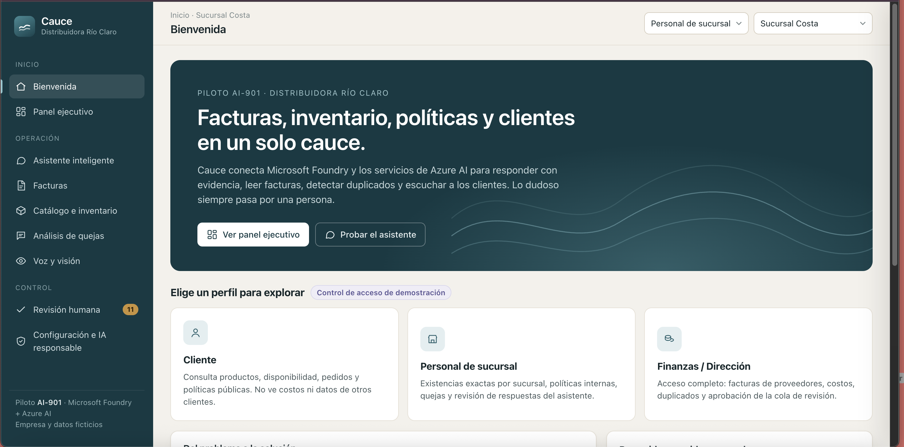

**2. Panel ejecutivo.** Consultas atendidas, facturas procesadas y en revisión, posibles duplicados, sentimiento de clientes, motivos de queja y actividad reciente, calculados con la actividad real de la aplicación.

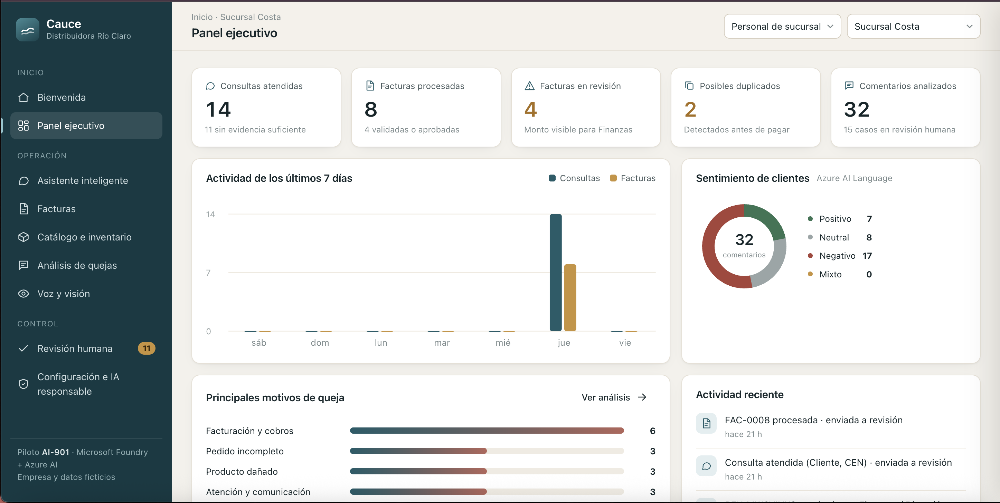

**3. Asistente: consulta de pedido como Cliente.** El agente consulta el sistema de pedidos, cita la fuente y la sucursal, y oculta montos y datos del cliente por tratarse del perfil Cliente.

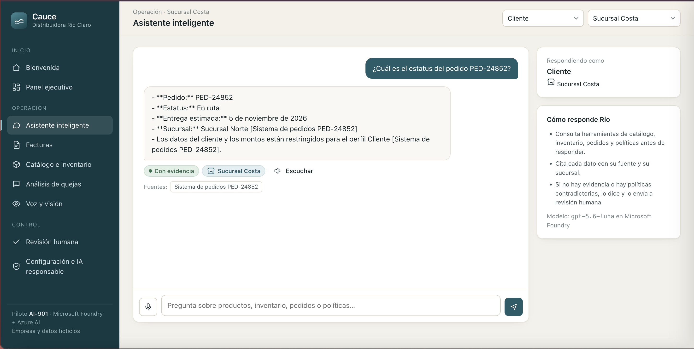

**4. Asistente: evidencia insuficiente.** Ante una pregunta que sus herramientas no pueden responder con certeza, el asistente no inventa una lista: declara que no tiene evidencia suficiente y envía el caso a revisión humana.

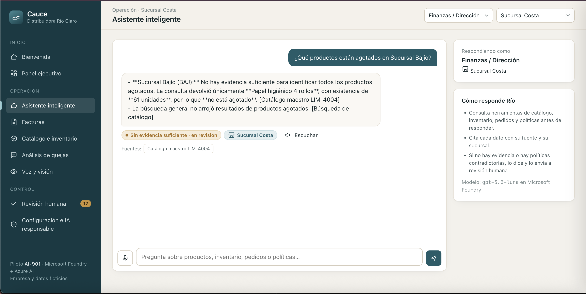

**5. Asistente por voz con conflicto de políticas.** Pregunta dictada por micrófono (Azure AI Speech). El agente detecta dos políticas de devoluciones contradictorias, cita ambas y escala el caso.

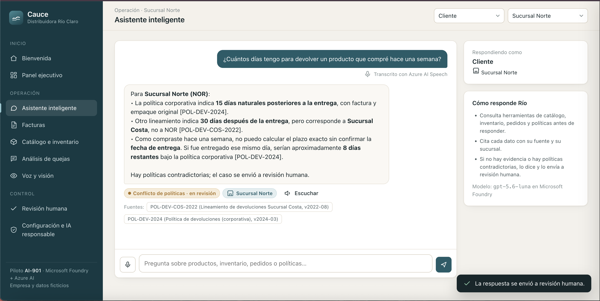

**6. Facturas: duplicado detectado.** Document Intelligence extrae proveedor, folio, fecha y total con confianza por campo. La factura se envía a revisión por archivo idéntico y folio repetido.

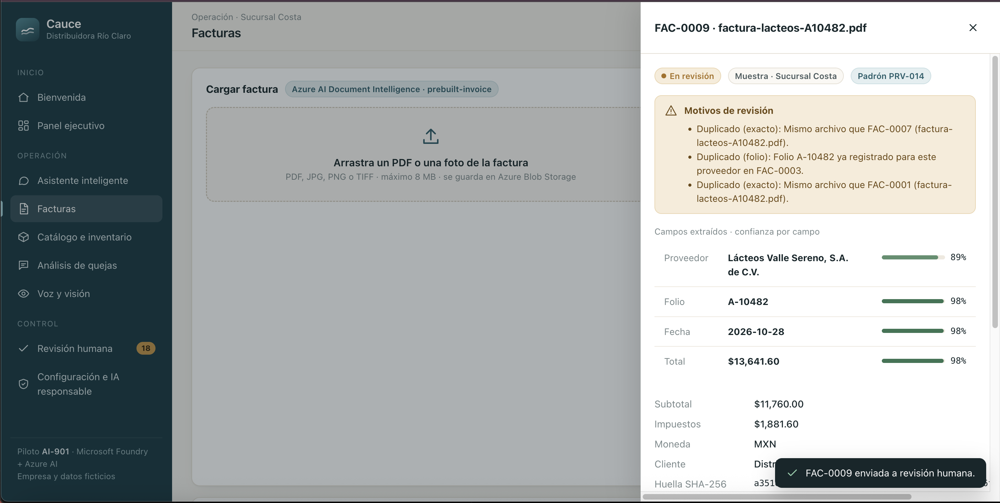

**7. Catálogo e inventario.** Catálogo maestro con existencias por sucursal y los nombres inconsistentes que usa cada sucursal. Costos y márgenes visibles solo para Finanzas.

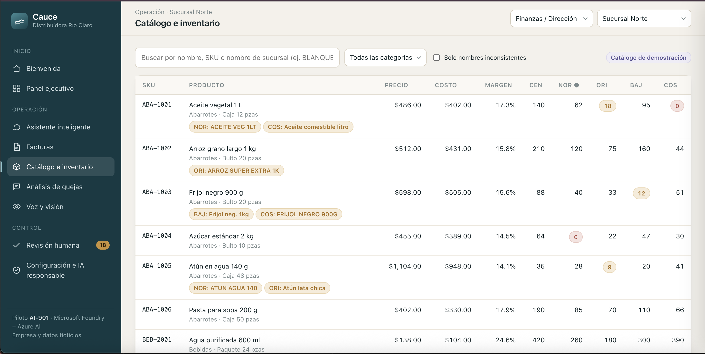

**8. Análisis de quejas.** Azure AI Language obtiene sentimiento y frases clave; Foundry clasifica el tema. Se listan los problemas recurrentes por sucursal.

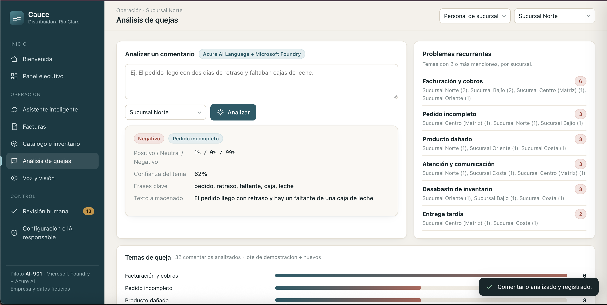

**9. Voz y visión.** Foto de un anaquel: Azure AI Vision extrae etiquetas y texto (OCR) y Foundry multimodal interpreta la escena, detecta el espacio vacío del nivel 2 y sugiere reponerlo. La sugerencia queda marcada para revisión.

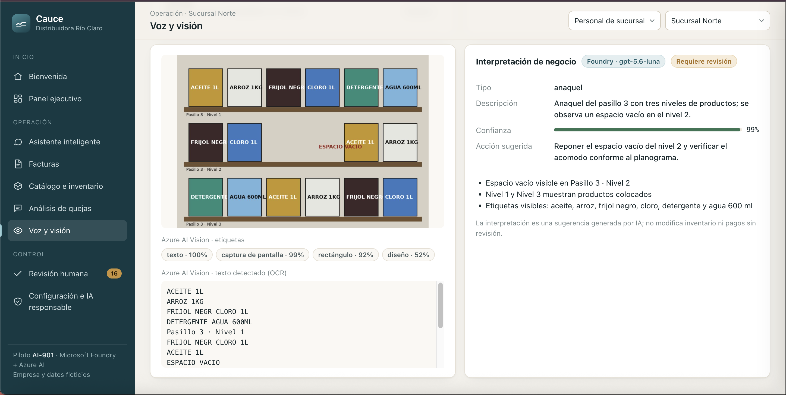

**10. Revisión humana.** Cola única de casos dudosos: facturas, respuestas sin evidencia o con conflicto y clasificaciones con baja confianza. Se aprueban, corrigen o rechazan con nota.

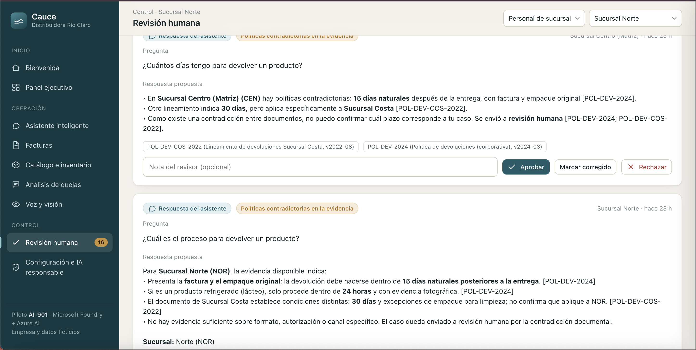

**11. Configuración e IA responsable.** Verificación en vivo de los seis servicios de Azure con su latencia, principios de IA responsable aplicados y matriz de acceso por perfil.

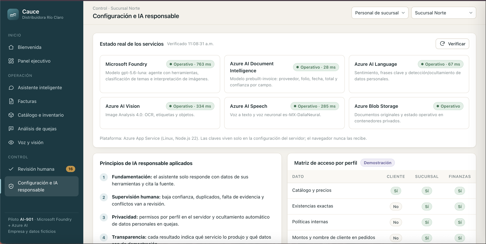

## 6. IA responsable

- **Fundamentación y transparencia:** respuestas solo con datos de herramientas, con fuente citada; cada resultado indica qué servicio lo produjo; los datos de demostración están rotulados.
- **Supervisión humana:** la IA no aprueba pagos ni publica respuestas dudosas; umbral de confianza configurable (`REVIEW_CONFIDENCE_THRESHOLD`, 0.80).
- **Privacidad y seguridad:** permisos por perfil aplicados en el servidor; PII ocultada en quejas; documentos en contenedores privados; claves solo en App Settings; HTTPS obligatorio; cabeceras de seguridad (CSP, nosniff).
- **Seguridad de contenido:** filtros de contenido de Azure en el modelo; límite de uso por IP para proteger el presupuesto.
- **Equidad e inclusión:** interfaz en español, responsive y con consulta por voz.

## 7. Limitaciones

- Los perfiles se eligen en pantalla para facilitar la evaluación; en producción se integraría Microsoft Entra ID (App Service Authentication).
- La base de conocimiento es un conjunto pequeño en memoria; a mayor escala se usaría Azure AI Search o el agente de Foundry con *file search*.
- Las claves se guardan en App Settings; en producción se usaría identidad administrada y Key Vault.
- Plan F1: arranque en frío de algunos segundos y cuota diaria de CPU.
- Transcripción de voz de hasta 15 segundos por consulta.
- Las facturas de muestra se generan con `tools/make_samples.py`; la foto oscura e inclinada puede obtener confianza menor y pasar a revisión.

## 8. Acceso y uso

1. Abre https://rioclaro-mayte-ai901-2026.azurewebsites.net
2. Elige un perfil en la bienvenida (o en el selector superior) y una sucursal.
3. Recorrido sugerido:
   - **Cliente → Asistente:** «¿Cuántos días tengo para devolver un producto?», «¿Tienen aceite vegetal en Sucursal Costa?», «¿Venden pintura?» (sin evidencia).
   - **Finanzas → Facturas:** procesa las muestras; abre una factura para ver confianza y duplicados.
   - **Finanzas → Revisión humana:** aprueba o rechaza casos.
   - **Quejas:** analiza un comentario nuevo.
   - **Voz y visión:** analiza la etiqueta de producto o el anaquel; usa el micrófono en el asistente (requiere permiso del navegador).
   - **IA responsable:** pulsa *Verificar* para comprobar los servicios.

### Ejecución local (opcional)

```bash
cp .env.example .env   # completar con los valores del recurso Foundry y Storage
npm install
node --env-file=.env server.js
```

## 9. Recursos y costos de Azure

| Recurso | Tipo / SKU | Costo estimado |
|---|---|---|
| `rg-rioclaro-ai901` | Grupo de recursos | Sin costo |
| `plan-rioclaro` | App Service Plan Linux **F1** | **Gratis** |
| `rioclaro-mayte-ai901-2026` | Web App Node.js 22 | Incluido en F1 |
| `strioclaroai901` | Storage StorageV2 LRS | < 0.10 USD/mes |
| `mayte-resource` | Foundry AIServices S0 (existente) | Pago por uso: ~0.01 USD por factura; centavos por cientos de consultas |

Alerta de presupuesto `presupuesto-rioclaro` en el grupo de recursos: 30 USD mensuales, avisos al 50 % y 90 % al propietario de la suscripción.

Estimado total del piloto: **menos de 5 USD** con uso de evaluación (presupuesto acordado: 30 USD).

## 10. Estructura del código

```
server.js                     API Express, seguridad y rutas
src/config.js                 Configuración desde variables de entorno
src/azure/http.js             Utilidades HTTP y errores de servicio
src/azure/foundry.js          Cliente del modelo en Microsoft Foundry
src/azure/cognitive.js        Document Intelligence, Language, Vision y Speech
src/services/access.js        Perfiles y permisos
src/services/knowledge.js     Búsqueda en catálogo, inventario, pedidos y políticas
src/services/assistant.js     Agente con herramientas y verificación de evidencia
src/services/invoices.js      Extracción, duplicados y reglas de revisión
src/services/complaints.js    Sentimiento, temas y problemas recurrentes
src/services/vision.js        Análisis de imágenes
src/services/store.js         Persistencia en Blob Storage
src/data/demo-data.js         Datos ficticios de la empresa
public/                       Interfaz web (HTML, CSS y JS sin dependencias externas)
public/samples/               Facturas e imágenes de muestra ficticias
```

## 11. Autoría y herramientas utilizadas

**Autora:** María Teresa Hernández Garduño.

Mi trabajo en el proyecto:
- Definí el caso de negocio, los requisitos, las restricciones de seguridad y el presupuesto máximo.
- Elegí y aprobé la arquitectura y cada recurso creado en mi suscripción de Azure, y reutilicé mi recurso existente de Microsoft Foundry.
- Configuré y validé el despliegue en Azure App Service y la alerta de presupuesto.
- Probé los flujos como evaluadora, incluida la consulta por voz, tomé las capturas y publiqué el repositorio.

Herramientas de asistencia: usé un asistente de programación con IA (Claude, de Anthropic) para generar y depurar el código y redactar la documentación bajo mis instrucciones. Revisé y probé los resultados antes de entregarlos. La solución en ejecución usa exclusivamente servicios de Microsoft Azure.
